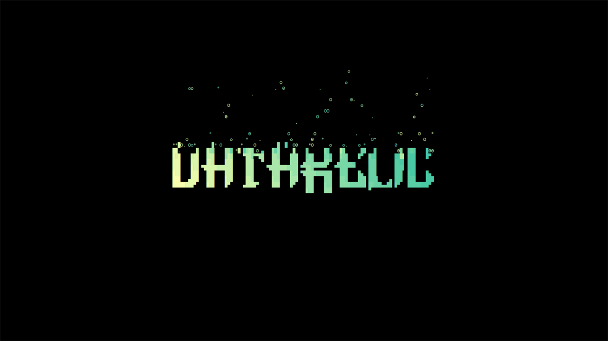

# textsaver

A Windows port of the [Omarchy](https://github.com/basecamp/omarchy) screensaver: your text in block
letters, animated with random [terminaltexteffects](https://github.com/ChrisBuilds/terminaltexteffects)
effects in a fullscreen console window on every monitor. Any key, click or mouse movement ends it.

It installs as a regular Windows screensaver, so Windows handles the idle timer and the lock on resume.

## Screenshots




The included effects are shown in the [terminaltexteffects showroom](https://chrisbuilds.github.io/terminaltexteffects/showroom/).

## Requirements

- Windows 10 or 11
- [uv](https://docs.astral.sh/uv/)

## Install

```powershell
uv tool install .
textsaver install
```

If `textsaver` is not recognised, uv's tool folder is not on your PATH. Run `uv tool update-shell` and
open a new terminal, or call `%USERPROFILE%\.local\bin\textsaver` directly.

`textsaver install` opens Screen Saver Settings with textsaver selected. Pick a timeout and click OK.

The installed copy is independent of this folder, so the clone can be moved or deleted afterwards.
It stops working only if the tool is uninstalled or the Python that uv installed it with is removed;
run the two commands above again to restore it.

## Usage

```powershell
textsaver start                 # run the screensaver now
textsaver text Hello            # change the text
textsaver text Hi --font slant  # use another figlet font
```

A new install shows the word `textsaver`. Replace it with `textsaver text`. The text is stored in
`%LOCALAPPDATA%\textsaver\screensaver.txt`. Edit that file by hand for multi-line or custom art, or
use the Settings button in Screen Saver Settings, which opens the same file. Short words work best:
text wider than the screen is clipped.

`uvx pyfiglet --list_fonts` lists the available fonts. The default, `delta_corps_priest_1`, is the
one Omarchy's logo uses.

While the screensaver runs, the mouse pointer is parked in the bottom-right corner of the primary
monitor.

## How it runs

Windows starts screensavers on a separate, empty desktop, where Windows Terminal cannot open a
window: a screensaver built on it works when started by hand but shows a black screen when Windows
triggers it. textsaver therefore uses the classic Windows console (`conhost.exe`), one fullscreen
window per monitor, with Consolas as the font because it draws block characters without gaps.

## Update

After pulling changes, reinstall the tool. The screensaver registration stays valid, so
`textsaver install` does not need to be run again.

```powershell
uv tool install . --reinstall
```

## Uninstall

```powershell
textsaver uninstall
uv tool uninstall textsaver
```

Then choose a different screensaver in Screen Saver Settings. Your text file is left in place.
