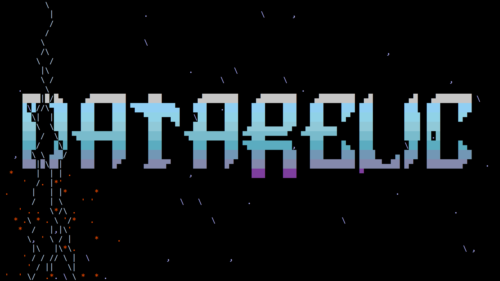

# textsaver

A Windows port of the [Omarchy](https://github.com/basecamp/omarchy) screensaver: your text in block
letters, animated with random [terminaltexteffects](https://github.com/ChrisBuilds/terminaltexteffects)
effects in a fullscreen console window on every monitor. Any key, click or mouse movement ends it.

It installs as a regular Windows screensaver, so Windows handles the idle timer and the lock on resume.

## Screenshots




The thunderstorm and fireworks effects, with `DATARELIC` as the text. All the effects are shown in
the [terminaltexteffects showroom](https://chrisbuilds.github.io/terminaltexteffects/showroom/).

## Requirements

- Windows 11
- [uv](https://docs.astral.sh/uv/), which also downloads Python 3.11 or later if you do not have it

textsaver has been tested on one Windows 11 PC with two monitors. If it misbehaves on your setup,
please [open an issue](https://github.com/DataRelic/textsaver/issues).

There is no prebuilt `.scr` to download. textsaver is a Python program, and its screensaver file is
a small launcher that only works on the PC it was installed on.

## Install

```powershell
git clone https://github.com/DataRelic/textsaver
cd textsaver
uv tool install .
textsaver install
```

If `textsaver` is not recognised, uv's tool folder is not on your PATH. Run `uv tool update-shell` and
open a new terminal, or call it by its full path: `& "$env:USERPROFILE\.local\bin\textsaver" install`.

`textsaver install` makes textsaver your screensaver and opens Screen Saver Settings with it
selected. Pick a timeout and click OK. It is installed for your Windows account only and needs no
administrator rights.

The installed copy is independent of the cloned folder, which can be moved or deleted afterwards.
It stops working only if the tool is uninstalled or the Python that uv installed it with is removed;
repeat the install to restore it.

## Usage

```powershell
textsaver start                 # run the screensaver now
textsaver text Hello            # change the text
textsaver text Hi --font slant  # use another figlet font
```

A new install shows the word `textsaver`. Replace it with `textsaver text`. The text is stored in
`%LOCALAPPDATA%\textsaver\screensaver.txt`. Edit that file by hand for multi-line or custom art, or
use the Settings button in Screen Saver Settings, which opens the same file. Short words work best:
they are shown at full size, while longer text gets a smaller font so that it fits. Text too wide
for even the smallest font is clipped.

`uvx pyfiglet --list_fonts` lists the available fonts. The default, `delta_corps_priest_1`, is the
one Omarchy's logo uses.

The text and its figlet font are the only settings. The timings and the console font size are
constants in the source; see [How it runs](#how-it-runs).

## Update

After pulling changes, reinstall the tool. The screensaver registration stays valid, so
`textsaver install` does not need to be run again.

```powershell
uv tool install . --reinstall
```

## Uninstall

```powershell
textsaver uninstall
uv tool uninstall textsaver
```

`textsaver uninstall` removes the screensaver file. If textsaver was the selected screensaver, it
also clears that selection, so Windows has no screensaver until you choose another in Screen Saver
Settings. Your text file is left in place; delete `%LOCALAPPDATA%\textsaver` to remove it.

## Known limitations

- The small preview monitor in Screen Saver Settings stays empty. The Preview button works.
- There is no settings dialog. The Settings button opens the text file in your editor.
- Every monitor shows the same text, each with its own random effect. The effects, their colours
  and their order cannot be chosen.
- Seven of the 37 effects (beams, blackhole, burn, decrypt, errorcorrect, matrix and waves) use
  characters that the console font, Consolas, does not have. The console draws boxed question
  marks in their place, as seen in beams, burn and waves.
- The classic console draws slowly, so the heaviest effects skip frames, most of all on large
  monitors.
- The mouse pointer is not hidden. It is parked in the bottom-right corner of the primary monitor
  and stays there when the screensaver ends.
- Input during the first second is ignored, and so is mouse movement of less than 20 pixels.

## How it runs

Windows starts screensavers on a separate, empty desktop, where Windows Terminal cannot open a
window: a screensaver built on it works when started by hand but shows a black screen when Windows
triggers it. textsaver therefore uses the classic Windows console (`conhost.exe`), one fullscreen
window per monitor, with Consolas as the font because it draws block characters without gaps.

The classic console draws slowly, and slowest when an effect repaints the whole screen. Two things
keep the effects moving:

- The font is large: 36 pt, or smaller (down to 18 pt) when the text would not fit the monitor.
  Fewer, larger cells are much cheaper to draw.
- The animations run on the clock at 120 steps per second, and only the frames the console has time
  for are drawn.

Each effect plays to its end and holds the screen for roughly 5 to 15 seconds. One that finishes
early leaves the text up until its 5 seconds are over; one still running after 15 seconds is hurried
to its finish. Matrix and swarm run with shorter settings than tte's defaults, because they would
otherwise take far longer. An effect that fails or hangs is cleared, and the next one starts. These
numbers and settings are at the top of `src/textsaver/cli.py`; the console font and its sizes are
the defaults of `fullscreen_console` in `src/textsaver/win32.py`.

## Development

```powershell
uv sync
uv run textsaver run     # the effect loop in the current terminal
uv run textsaver start   # the full screensaver, on every monitor
```

The code is two modules in `src/textsaver`: `cli.py` holds the commands, the effect loop and the
screensaver entry point (`/s`, `/p`, `/c`), and `win32.py` holds the Win32 calls. There are no
automated tests.

## License

[MIT](LICENSE). textsaver builds on [terminaltexteffects](https://github.com/ChrisBuilds/terminaltexteffects)
and [pyfiglet](https://github.com/pwaller/pyfiglet), and takes its idea from
[Omarchy](https://github.com/basecamp/omarchy).
